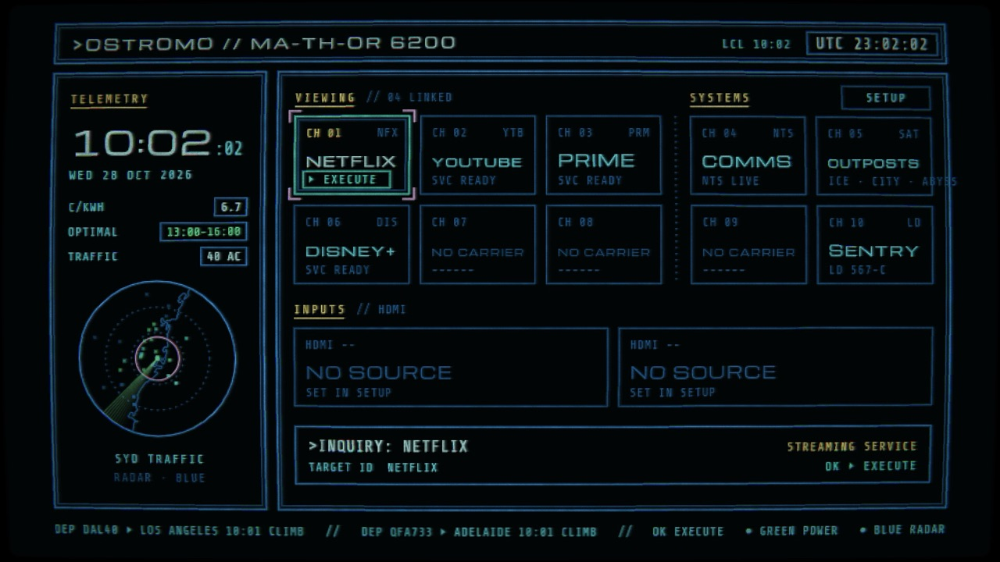
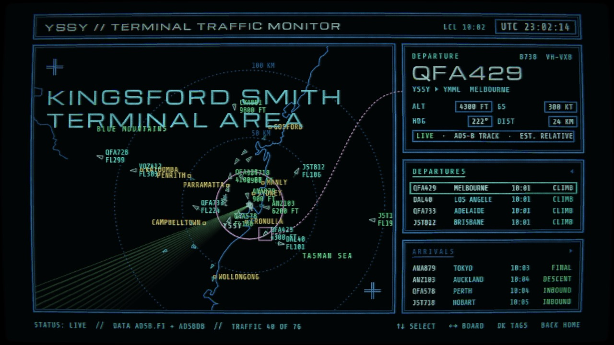
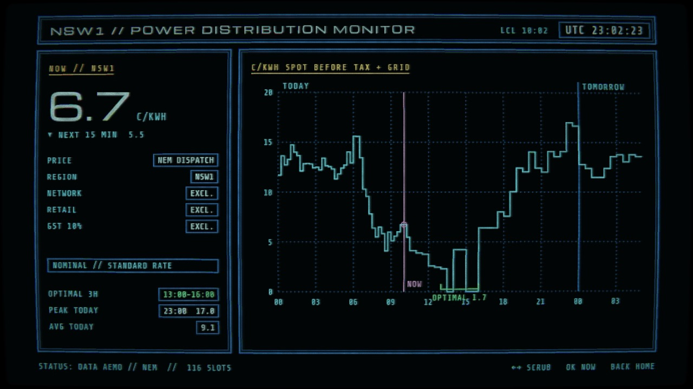

# Ostromo for Android TV

> [!NOTE]
> Not finished software. A home screen I made for my own TV, shared as is. Expect to tweak it, with some
> coding know-how or a coding agent like Claude Code, and use it at your own risk.

## TL;DR

1. **On the TV:** turn on developer options, install the free **Downloader** app from the Play Store and let it
   install apps.
2. **In Downloader,** type `staiola.studio/android-tv`, press Go and install.
3. **Open Ostromo** and pick your apps, airport and power prices in SETUP.

Only the TV and its remote, no computer. Step by step: **[the install guide](INSTALL.md)**.

A home screen for Android TV and Google TV that looks like the ship computers in *Alien* and *Aliens*: blue
vector lines on black, a worn picture tube, and a boot card that plots itself on. It launches your streaming
apps and HDMI inputs, and around them it shows live flights around a big airport near you, today's
electricity prices, webcams at research stations, NTS radio, teletext and a sentry gun.



More about it, with video: [staiola.studio/apps/ostromo](https://staiola.studio/apps/ostromo). It started on
LG TVs: [Ostromo for LG](https://github.com/Staiola/Ostromo-for-LG).

## Try it

Version 0.10.1 is a beta, and the second for Android TV: streaming tiles now find their app by package name. It runs on TVs and boxes with Android TV or Google TV
(TCL, Sony, Philips, Hisense, Chromecast with Google TV, Google TV Streamer, Nvidia Shield …), Android 8 or
newer. Tested on the Google TV emulator and a Pixel so far, not yet on a real TV:
[tell me how it runs on yours](https://github.com/Staiola/Ostromo-for-Android-TV/issues). It's free.

What's in it:

- **Radar:** live air traffic around one of 14 airports: Copenhagen, Malmö, Stockholm, Oslo, Berlin, Paris,
  London, New York, Washington, Sydney, Melbourne, Brisbane, Adelaide or Perth, with departure and arrival
  boards, routes and altitudes.
- **Power:** today's and tomorrow's electricity price every quarter of an hour, and the cheapest three hours.
  Denmark, Sweden, Norway, Germany, London (Octopus Agile), New York City and eastern Australia (the NEM).
- **Teletext:** DR (Denmark), SVT (Sweden) or ARD (Germany), live.
- **Comms** (NTS Live radio), **Outposts** (polar and deep-sea webcams), **Sentry** (a small defence game),
  and **DR TV** (Danish live TV, Denmark only).





## The code

Everything is in this repository, under the [MIT licence](LICENSE): change it, share it, build on it.

| Folder | What's in it |
|---|---|
| `nostromo/` | The app itself: plain JavaScript drawing into a canvas, with a WebGL pass for the CRT look. One file per screen (`home.js`, `radar.js`, `power.js`, `sentry.js` …). The same code runs on LG TVs. |
| `android-tv/` | The Android TV app: a full-screen WebView around `nostromo/`, copied in at build time. The feeds the app can't reach directly (flights, Danish and New York power prices, webcams, DR teletext) are answered in Kotlin, and `Launcher.kt` lists and opens the TV's apps. |
| `nostromo-service/` | The same feeds in Node, for running the app in a browser on your computer (`dev-server.js`). |
| `scripts/` | `make-android-key.sh` makes your own signing key for release builds. |

**Run it in a browser** (needs [Node.js](https://nodejs.org)), then open http://localhost:8081. Arrow keys,
Enter and Esc stand in for the remote.

```bash
node nostromo-service/dev-server.js 8081
```

**Build the app** (needs Java 17 and the Android SDK, e.g. from Android Studio; open `android-tv/` in
Android Studio, or):

```bash
cd android-tv
./gradlew installDebug
```

`installDebug` puts it on a TV or emulator connected with `adb`. A debug build can be inspected from Chrome
at `chrome://inspect`. For a release build of your own, make a key with `scripts/make-android-key.sh`, then
`./gradlew assembleRelease`.

**Start with your own setup instead of SETUP:** copy `nostromo/preset.example.js` to `nostromo/preset.js`
and edit it (debug builds include it, release builds leave it out).

Places to start tweaking:

- Apps a tile can launch: `nostromo/settings.js` (they're found by name on Android).
- Airports: `nostromo/airports.js`. The coastlines, lakes and rivers in `nostromo/maps.js` are clipped from
  Natural Earth.
- Power prices: the regions in `nostromo/settings.js`, and how each source is read in `nostromo/power.js`.
- The CRT look: `nostromo/fx.js`.

Pointing Claude Code at this repository and describing what you want changed works well. Most of Ostromo
was made that way.

## Follow along

- On GitHub: **Watch → Custom → Releases** on this repository and you get a notice when there is something to install.
- Found a problem? [Open an issue](https://github.com/Staiola/Ostromo-for-Android-TV/issues) and say which TV or box you have.
- Like it? You can [support Ostromo on Ko-fi](https://ko-fi.com/F2F0LWM3Y).

## Credits

- Fonts: Michroma and Share Tech Mono (SIL Open Font License), Bedstead (CC0). Licences in `nostromo/fonts/`.
- Video playback: [hls.js](https://github.com/video-dev/hls.js) (Apache 2.0), in `nostromo/lib/`.
- Map outlines: [Natural Earth](https://www.naturalearthdata.com) (public domain).
- Data: flights from [adsb.fi](https://adsb.fi) (personal, non-commercial use) and [adsbdb](https://www.adsbdb.com);
  electricity prices from Energinet's [Energi Data Service](https://www.energidataservice.dk),
  [elprisetjustnu.se](https://www.elprisetjustnu.se), [hvakosterstrommen.no](https://www.hvakosterstrommen.no),
  [Octopus Energy](https://octopus.energy), [NYISO](https://www.nyiso.com) and [AEMO](https://aemo.com.au);
  teletext from DR, SVT (via [texttv.nu](https://texttv.nu)) and [ARD Text](https://www.ard-text.de); radio from
  [NTS](https://www.nts.live); live TV from [DR](https://www.dr.dk); webcams from the US Antarctic Program,
  the Australian Antarctic Division, the Norwegian Polar Institute, Øresundsbron, the Gemini Observatory and
  the Ocean Observatories Initiative. Their terms apply to their data.

---

Ostromo is a fan's homage to the screens in *Alien* (1979), *Aliens* (1986) and *WarGames* (1983), and has
nothing to do with the people who made them.
